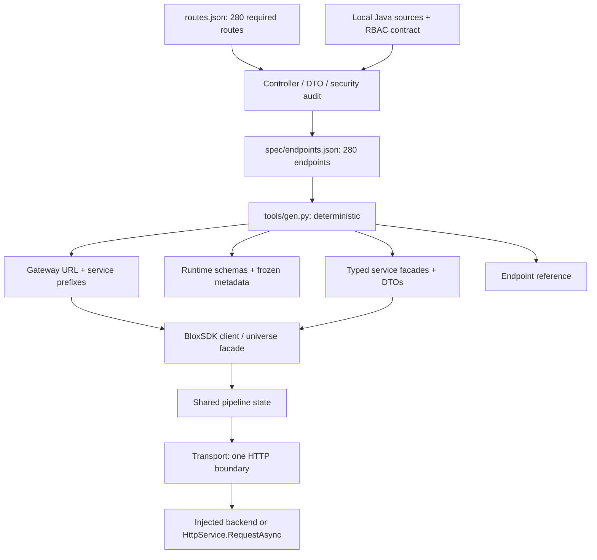
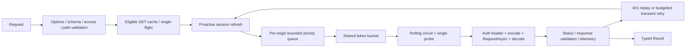

# Architecture

## Separation of responsibilities

`Pipeline` orchestrates stages; algorithms live in dedicated `Gate`, `Breaker`, `TokenBucket`, `Retry`, `Cache`, `Path`, `Validation`, and `Transport` modules. State is allocated once per client, not rebuilt as a closure stack for each call. All universe facades share that state. No background pollers or startup requests are implicit. Explicit auditWriter/configSnapshot factories own bounded background work; flush/destroy owns their shared lifecycle.

Generated methods only adapt typed arguments to `Invoke`. The untyped entry validates request structure, generated DTO schemas, scope/access hints, and declared parameters. Unknown request fields are rejected; unknown response fields are tolerated for forward compatibility. Arbitrary `JsonNode` payloads remain open JSON. Java nullable fields are represented conservatively as optional; semantic Bean Validation constraints remain server-enforced.

`tools/gen.py` owns the gateway and prefix declarations; generated `Core/Routing` supplies frozen defaults.
`Core/Config` resolves `gatewayUrl` and optional `services[service].baseUrl` into immutable origin and wire-base maps
before accessing Roblox or credentials. `Pipeline` joins the wire base to the encoded backend path exactly once.
Origins, not prefixed bases, key gates and breakers: the default eight services share one gateway origin.
Explicit direct-host overrides omit the gateway prefix. See [all prefixes and URL examples](../README.md#gateway-routing).

The backend interface is `(HttpRequest) -> HttpResponse`; the runtime supplies monotonic/unix clocks, random, scheduler, encoder, and decoder. Exactly one transport-edge protected call contains credential application, encoding, backend invocation, decoding, and response validation. Optional observer callbacks have their own protected boundary, never receive bodies/headers, and cannot fail requests.

## Packaging

Portable modules use static relative string requires so real `luau-analyze` can resolve all types without a pretend Roblox API. `tools/build-roblox.py` projects only import expressions to `script.Parent...`, preserving the implementation and exported types. `roblox/init.luau` contains the client root and its child modules. The portable `src/init.luau` follows the Luau CLI's package-relative convention; Lune tests require `src/BloxSDK.luau` directly.

Projection is checked byte-for-byte. A ModuleScript-resolution harness executes the *same complete suite* against the generated package; Rojo builds it too. This is stronger than merely copying untested Roblox require paths, but does not replace Studio typechecking/play testing against engine datatypes.

## Ownership and concurrency

No header pooling: each request owns its header table until native HTTP completion, then clears it. This avoids credential cross-contamination and late-response reuse races. Native HTTP workers own their gate slots. Timed-out/cancelled observers do not release physical slots early. Timer tasks are cancelled after successful completion or cancellation; late native results are discarded.

Single-flight is client-local, keyed by endpoint, canonical URL, auth generation, write-invalidation epoch, and compatible call policies. Calls with custom signals or explicit deadlines are intentionally independent. Cache entries and shared responses are deeply frozen. Any successful mutation invalidates the cache; in-flight reads retain their earlier epoch and cannot repopulate the current namespace.

`flush()` drains audit writers and stops snapshot pollers before it closes admission and waits for logical/native work for a bounded duration. `destroy()` cancels waiters, clears cache/credentials, and invalidates all facades. Neither operation can undo an already-executing server mutation.

## Fields ownership

Generated `Services/Fields` delegates helpers to `Fields/Client`; no generated HTTP wrapper is hand-edited.
TypeExpr is a closed exported recursive union. Schema compilation is atomic per generation. Transaction
builders validate all ops before calling Invoke, seal private payloads and keep one identity across retries.
Profiles apply acknowledged after-subvalues and refresh snapshot state across sequence gaps/NONE history.
Shared helper state owns caches, presence timers and bounded close work. See [Fields](FIELDS.md).

## Shared operation templates

`Fields/Operations` owns subject-free structure validation, canonicalization and ordered diagnostics.
`Fields/OpBuilder` composes it for dry runs; `Codes/Award` reuses that builder and the same universe schema
cache. Transactions use the shared constructor and TypeSystem, retaining full commit validation and
per-transaction identity. Codes never choose a downstream key or emulate a player-state mutation locally.
Generated facades delegate only the handwritten preflight; transport/retry/auth remain in one pipeline.

`Fields/Bulk` composes the same operation builder; `Fields/Control` validates closed target/filter and
schedule-action grammar. `Fields/Jobs` validates import/export requests and offers synchronous bounded
polling; it never owns durable execution or implicitly mutates a job. `Fields/Schedules` validates UTC
windows while backend workers own their timing and effects. Typed helpers provide preflight only;
raw generated wrappers retain server-authoritative semantics. NDJSON import uses raw string transport
and an explicit header key, while export/failure downloads return buffered text. See [Jobs](JOBS.md).

Identity and scoped credentials are separate providers. `client:scoped(id)` binds a hand-written
ScopedTokens provider to the shared pipeline without mutating its global auth. Each universe shares one
exchange flight and token cache; identity epoch changes fence stale exchanges. Scoped Fields helper states
share the root shutdown lifecycle but use their own credential-bound invoker.
