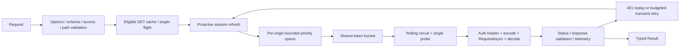

# Architecture

## Separation of responsibilities

`Pipeline` orchestrates stages; algorithms live in dedicated `Gate`, `Breaker`, `TokenBucket`, `Retry`, `Cache`, `Path`, `Validation`, and `Transport` modules. State is allocated once per client, not rebuilt as a closure stack for each call. All universe facades share that state. No background pollers or startup requests are implicit. Explicit auditWriter/configSnapshot factories own bounded background work; flush/destroy owns their shared lifecycle.

Generated methods only adapt typed arguments to `Invoke`. The untyped entry validates request structure, generated DTO schemas, scope/access hints, and declared parameters. Unknown request fields are rejected; unknown response fields are tolerated for forward compatibility. Arbitrary `JsonNode` payloads remain open JSON. Java nullable fields are represented conservatively as optional; semantic Bean Validation constraints remain server-enforced.

`tools/gen.py` owns the gateway and prefix declarations; generated `Core/Routing` supplies frozen defaults.
`Core/Config` resolves `gatewayUrl` and optional `services[service].baseUrl` into immutable origin and wire-base maps
before accessing Roblox or credentials. `Pipeline` joins the wire base to the encoded backend path exactly once.
Origins, not prefixed bases, key gates and breakers: the default nine services share one gateway origin.
Explicit direct-host overrides omit the gateway prefix. See [all prefixes and URL examples](../README.md#gateway-routing).

The backend interface is `(HttpRequest) -> HttpResponse`; the runtime supplies monotonic/unix clocks, random, scheduler, encoder, and decoder. Exactly one transport-edge protected call contains credential application, encoding, backend invocation, decoding, and response validation. Optional observer callbacks have their own protected boundary, never receive bodies/headers, and cannot fail requests.

## Packaging

Portable modules use static relative string requires so real `luau-analyze` can resolve all types without a pretend Roblox API. `tools/build-roblox.py` projects only import expressions to `script.Parent...`, preserving the implementation and exported types. `roblox/init.luau` contains the client root and its child modules. The portable `src/init.luau` follows the Luau CLI's package-relative convention; Lune tests require `src/BloxSDK.luau` directly.

Projection is checked byte-for-byte. A ModuleScript-resolution harness executes the *same complete suite* against the generated package; Rojo builds it too. This is stronger than merely copying untested Roblox require paths, but does not replace Studio typechecking/play testing against engine datatypes.

## Ownership and concurrency

No header pooling: each request owns its header table until native HTTP completion, then clears it. This avoids credential cross-contamination and late-response reuse races. Native HTTP workers own their gate slots. Timed-out/cancelled observers do not release physical slots early. Timer tasks are cancelled after successful completion or cancellation; late native results are discarded.

Single-flight is client-local, keyed by endpoint, canonical URL, auth generation, write-invalidation epoch, and compatible call policies. Calls with custom signals or explicit deadlines are intentionally independent. Cache entries and shared responses are deeply frozen. Any successful mutation invalidates the cache; in-flight reads retain their earlier epoch and cannot repopulate the current namespace.

`flush()` drains audit writers and stops snapshot pollers before it closes admission and waits for logical/native work for a bounded duration. `destroy()` cancels waiters, clears cache/credentials, and invalidates all facades. Neither operation can undo an already-executing server mutation.
