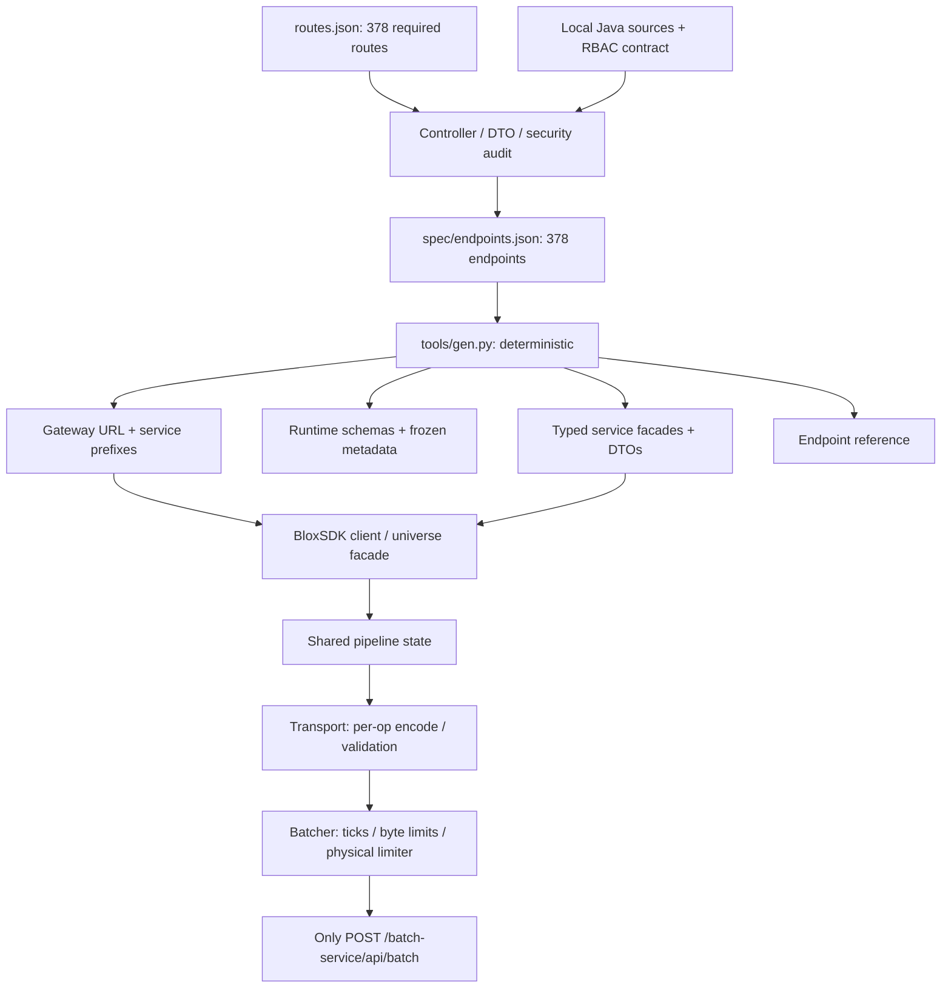

# Architecture

## Runtime boundary

The shared Pipeline owns endpoint validation, access, auth preparation, cache/singleflight, logical
player-order locks and retries. Transport encodes an op and awaits the Batcher; it cannot call HTTP.
Batcher alone owns physical admission and invokes the backend with a bounded envelope. ProfileSync
is a tick producer, not a second transport or HTTP loop. Priorities are stable critical/bulk/low lanes;
player/multi-subject ordering is held through retries. Different credential providers wait for
compatible envelopes instead of putting credentials in JSON.

A single lazy cadence clock sends at most one envelope per tick with one native batch in flight.
Timeouts and cancellation stop logical waiters, not native HTTP. The rolling limiter charges batches.
Cache/singleflight values are immutable and successful mutations invalidate reads. `flush` stops sync
and owned helpers before closing admission; `destroy` cancels queued work and shared facades.
See [batching](BATCHING.md) and [fault tolerance](FAULT-TOLERANCE.md).

## Fields ownership

Generated `Services/Fields` delegates helpers to `Fields/Client`; no generated HTTP wrapper is hand-edited.
TypeExpr is a closed exported recursive union. Schema compilation is atomic per generation. Transaction
builders validate all ops before calling Invoke, seal private payloads and keep one identity across retries.
Profiles reconcile acknowledged after-subvalues by per-field version, never by sparse mutation tokens.
Only coherent documents advance profile watermarks; feeds drain via nextSinceSeq before snapshot recovery
for real version/schema gaps, NONE history and hash-only values. Sync reads bypass stale caches/coalescing.
Shared helper state owns caches, presence timers and bounded close work. See [Fields](FIELDS.md).

## Shared operation templates

`Fields/Operations` owns subject-free structure validation, canonicalization and ordered diagnostics.
`Fields/OpBuilder` composes it for dry runs; `Codes/Award` reuses that builder and the same universe schema
cache. Transactions use the shared constructor and TypeSystem, retaining full commit validation and
per-transaction identity. Codes never choose a downstream key or emulate a player-state mutation locally.
Generated facades delegate only the handwritten preflight; transport/retry/auth remain in one pipeline.

`Fields/Bulk` composes the same operation builder; `Fields/Control` validates closed target/filter and
schedule-action grammar. `Fields/Jobs` validates import/export requests and offers synchronous bounded
polling; it never owns durable execution or implicitly mutates a job. `Fields/Schedules` validates UTC
windows while backend workers own their timing and effects. Typed helpers provide preflight only;
raw generated wrappers retain server-authoritative semantics. NDJSON import uses raw string transport
and an explicit header key, while export/failure downloads return buffered text. See [Jobs](JOBS.md).

Identity and scoped credentials are separate providers. `client:scoped(id)` binds a hand-written
ScopedTokens provider to the shared pipeline without mutating its global auth. Each universe shares one
exchange flight and token cache; identity epoch changes fence stale exchanges. Scoped Fields helper states
share the root shutdown lifecycle but use their own credential-bound invoker.

## 3.0 sessions

`Fields/Sessions` owns fenced leases, per-tick acquire/control groups, shared commit serialization and immutable retry identities. Profiles retain an authoritative base plus detached/pending optimistic overlays. `LeaseLost` invalidates a handle; `CommitRejected` discards only the rejected detached ops before a coherent recovery barrier. Close saves before release and only then closes the pipeline. Native PlayerAdded and removal hooks own the lifecycle. See [binding contract](../API_CONTRACT.md).
